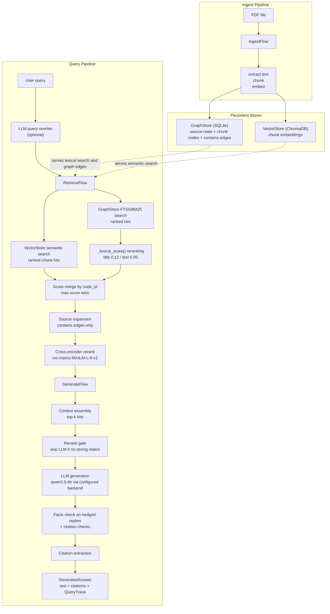

# Research Continuity Agent (RCA)


RCA answers questions about your own research papers with a small local model, cites the passage it used, and says "not in your papers" when that is the truth. It ingests PDFs into a SQLite graph plus a Chroma vector index, retrieves with BM25, dense search, graph expansion and a cross-encoder, and runs fully local on Ollama (`qwen3.5:4b`, 4 GB). It was built as the research memory for work on structured perception for robotic grocery bagging.

## Results at a glance

<!-- scorecard:start (generated by eval/scorecard.py from eval/scorecard.json) -->
Held-out test split, 40 questions (28 answerable, 12 unanswerable), shipped defaults: `qwen3.5:4b` for answers and query rewrites, facts check on. Intervals are Wilson 95%.

| Test split | Result | 95% interval |
|---|---|---|
| Answerable: answered, citing the expected paper | `24/28` (86%) | 68% to 94% |
| Answerable: refused | `3/28` (11%) | 4% to 27% |
| Unanswerable: refused ("not in your papers") | `12/12` (100%) | 76% to 100% |
| When it answers: cites every expected paper | `24/25` (96%) | 80% to 99% |
| Retrieval: expected paper in the top 5 | `27/28` (96%) | 82% to 99% |
| Answer keyword hit rate (answerable, mean) | `0.595` | |
| Time per question | mean `8.9 s`, median `8.9 s` | |

Misses. Answerable refused: `review-002`, `cross-004`, `autobag-004`. Answered without the expected citation: `pic2-009`. Unanswerable answered: none. Expected paper not in the top 5: `cross-004`.

Run `20261111T173354Z`, commit `77ec660`, corpus `51b6785c3405cb16`. Reproduce: `uv run python eval/harness.py --split test`, then `uv run python eval/scorecard.py eval/results/run_<timestamp>.json`.
<!-- scorecard:end -->

Measured separately, not part of the scorecard:

| What | Result | Details |
|---|---|---|
| Agent benchmark (`qwen3.5:9b`, 20 sandboxed tasks; default `qwen3.5:4b`: `17/20`) | `19/20` tasks, right tool `18/18` | [EVAL.md → Agent Evaluation](docs/EVAL.md#agent-evaluation) |
| Retrieval regression gate in CI | fails the build when any fixture question ranks worse | [EVAL.md → CI Retrieval Gate](docs/EVAL.md#ci-retrieval-gate) |

Golden set: 129 questions, 39 of them unanswerable, split 89 dev (tuning) / 40 test (reported above). Known gaps: [Known Limitations](docs/EVAL.md#known-limitations).

## Try the demo

Requires [Docker](https://docs.docker.com/get-docker/) and [Ollama](https://ollama.com) running on the host. Only the default Ollama backend has been tested with the demo.

```bash
ollama pull nomic-embed-text && ollama pull qwen3.5:4b
git clone https://github.com/DmcpEI/Research-Continuity-Agent.git && cd Research-Continuity-Agent
docker compose up --build demo      # or: make demo
```

Open http://localhost:8000. The first start downloads five CC BY 4.0 papers from arXiv (listed in [demo/papers.json](demo/papers.json)) and ingests them. That takes a few minutes; later starts re-check the files but skip re-indexing unchanged ones. The server listens on localhost only. Data lives in Docker volumes, separate from your own `.rca/` store; `docker compose --profile demo down -v` removes it.

Things to try:
- *What does JSONSchemaBench measure?* should answer with `[[chk:...]]` chunk citations; click one to open the PDF. The default `qwen3.5:4b` sometimes answers without citation tags (see [Known Limitations](docs/EVAL.md#known-limitations)).
- *How does the planner use the scene graph to guide search?* answers from the scene-graph planning paper.
- *What is the capital of Australia?* is out of corpus, so RCA says nothing relevant was found instead of generating an answer.
- The Agent tab uses the same `qwen3.5:4b` (17/20 agent tasks); it can search the knowledge base and list the downloaded papers.

## How it works




- **Ingest.** PDFs, notes, experiment files and git repos become a source node plus ~1,200-character chunks in SQLite (with an FTS5 index) and Chroma. Re-ingest is idempotent: file and content hashes resolve the same source, and every revision is recorded.
- **Retrieve.** Query-type-aware rewrite (skipped for named papers), FTS5/BM25 and dense search merged by node, expansion to parent sources, then a cross-encoder rerank. When the 5th hit would repeat a paper already shown, that slot goes to the best-ranked unseen paper above a rerank floor.
- **Answer.** The model sees each chunk's full text and must cite `[[id]]` tags. It is not called at all when the best rerank score is below a threshold calibrated on the dev split. A reply that hedges goes to a facts check (a second call that lists what it actually answers); nothing means RCA declines. Every answer carries an outcome (`answered`, `unverified`, `not_found`, `conversational`) and a per-stage trace.
- **Agent.** A separate multi-turn tool loop with knowledge-base search and read-only MCP tools for files and experiment runs. Grounded chat does not go through it.
- **Why two stores:** Chroma for nearest-neighbour search; SQLite for the document registry, FTS5, provenance and chunk-to-source resolution, with zero infrastructure.

Details: [ARCHITECTURE.md](docs/ARCHITECTURE.md), [DATA_MODEL.md](docs/DATA_MODEL.md).

## Run it locally

Requires Python 3.11+, [uv](https://docs.astral.sh/uv/), [ripgrep](https://github.com/BurntSushi/ripgrep) and [Ollama](https://ollama.com).

```bash
ollama pull nomic-embed-text && ollama pull qwen3.5:4b
uv sync --extra dev
cp .env.example .env
for f in path/to/papers/*.pdf; do uv run rca-ingest "$f"; done    # one file per call; a folder is read as a git repo
uv run uvicorn rca.api.main:create_site --factory --port 8000      # app + API on http://localhost:8000
```

Or with Docker: `docker compose up --build rca` (or `make run`) serves your `./.rca` library on `http://localhost:8000`.

Frontend development: `uv run uvicorn rca.api.main:app --reload --port 8000` and `cd frontend && npm run dev` (Vite proxies `/api/*` to the API).

Always run Python through `uv run`: the system Python lacks ChromaDB and silently falls back to the JSON vector store.

**Configuration.** Every setting is an `RCA_*` variable; [.env.example](.env.example) lists the common ones with defaults, and `Settings._env_field_map` in `rca/config/settings.py` has the full list. The ones you are most likely to change:

| Variable | Default | Meaning |
|---|---|---|
| `RCA_GENERATION_MODEL` / `RCA_AGENT_MODEL` | `qwen3.5:4b` | Chat and agent model |
| `RCA_EMBEDDING_MODEL` | `nomic-embed-text` | Embeddings; changing it means re-ingesting |
| `RCA_LLM_BACKEND` | `ollama` | `ollama` or `openai_compatible` (then set `RCA_OPENAI_*`) |
| `RCA_FACTS_CHECK_ENABLED` | `true` | Facts check on hedged replies |
| `RCA_LLM_KEEP_ALIVE` | `1m` | How long Ollama keeps a model loaded |
| `RCA_DATA_DIR` | `.rca` | Library location (set the store paths too; see PLAN.md) |
| `RCA_ENABLE_FILESYSTEM_TOOLS` / `RCA_FILESYSTEM_ROOT` | `true` / cwd | Agent file tools and their sandbox root |

**Tests and hooks** (the same commands CI runs):

```bash
uv run ruff check . && uv run ruff format --check . && uv run pytest -v --tb=short
cd frontend && npm ci && npm run typecheck && npm run build && npm test
uv run pre-commit install    # pre-commit: ruff; pre-push: pytest + frontend checks
```

`frontend/dist` is committed; if a push is blocked because the build rewrote it, commit the rebuilt files and push again.

## Evaluation

The published numbers are the scorecard above: `eval/harness.py --split test` runs the 40 held-out questions with the shipped defaults and `eval/scorecard.py` publishes the run, refusing any run made from uncommitted code, with a degraded component or with non-default settings. Dev-split runs are for tuning only. Also in `eval/`: retrieval ablations, the rerank-gate calibration, hand-labelled answer outcomes with a classifier comparison, and the agent benchmark. Methods, history and caveats: [EVAL.md](docs/EVAL.md).

## Project structure

```
.
├── rca/                        # Main package
│   ├── config/                 # Settings (pydantic-settings, RCA_ env prefix)
│   ├── contracts/              # Shared data models: node/edge types, ID rules, citations, traces
│   ├── store/                  # Persistence only: GraphStore (SQLite), VectorStore (ChromaDB)
│   │   └── migrations/         # SQL schema applied on GraphStore init
│   ├── extractors/             # Turn files into text payloads: PDF, Markdown, Git, Experiment
│   ├── flows/                  # Compose extractors and stores into workflows
│   │   ├── ingest_flow.py      # File → chunks → graph + vector store
│   │   ├── retrieve_flow.py    # Vector + lexical search, graph expansion, scored bundles
│   │   └── generate_flow.py    # Query rewriting → retrieval → grounded LLM answer
│   ├── api/                    # FastAPI app; create_site also serves the built React app
│   ├── retrieval/              # Query classifier and cross-encoder reranker
│   ├── agent/                  # Agent loop, MCP client manager, tool registry, trace contracts
│   ├── llm/                    # LLM client interface: OllamaLLMClient, EchoLLMClient
│   ├── telemetry/              # Run provenance for eval artifacts
│   └── mcp_servers/
│       ├── filesystem/         # MCP server: sandboxed file access and ripgrep search
│       └── experiments/        # MCP server: experiment run CRUD over SQLite
├── cli/                        # Entry points: rca-ingest, rca-query, and rca_demo (the Docker demo)
├── frontend/                   # React (Vite) app; dist/ is committed
├── eval/                       # Golden question set, evaluation harness, and run results
├── tests/
│   ├── unit/                   # Contract and store unit tests
│   └── integration/            # End-to-end ingest and generate flow tests
└── docs/                       # Architecture, data model, and evaluation documentation
```

## Docs

- [PLAN.md](docs/PLAN.md): the plan, decisions and open questions (the only roadmap)
- [EVAL.md](docs/EVAL.md): evaluation methods, results and limitations
- [ARCHITECTURE.md](docs/ARCHITECTURE.md) and [DATA_MODEL.md](docs/DATA_MODEL.md): how it is built
- [DESIGN.md](docs/DESIGN.md): UI review and design system
- [CHANGELOG.md](CHANGELOG.md): what changed, with migrations
